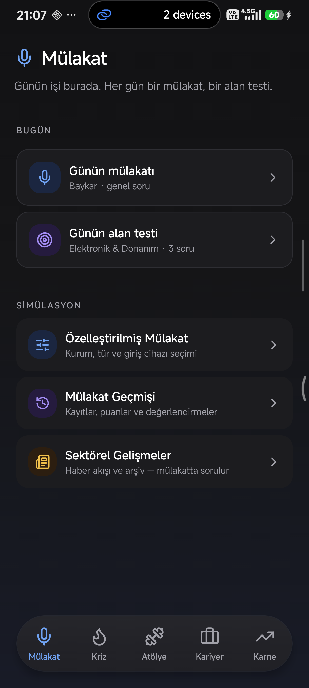
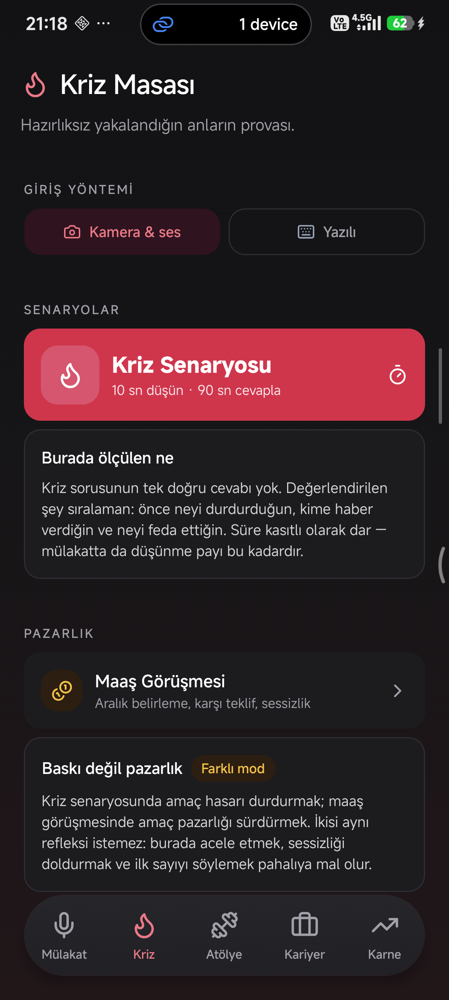
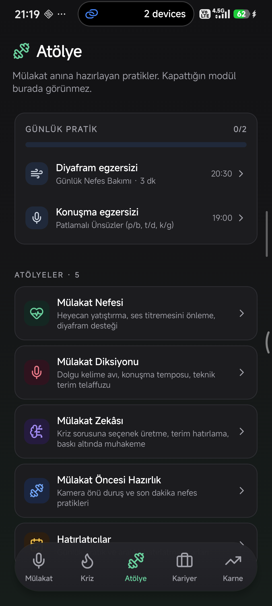
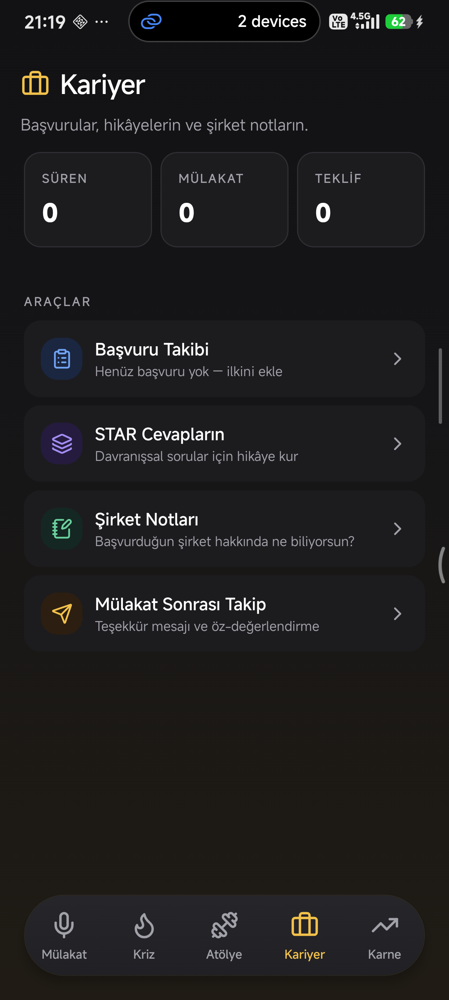
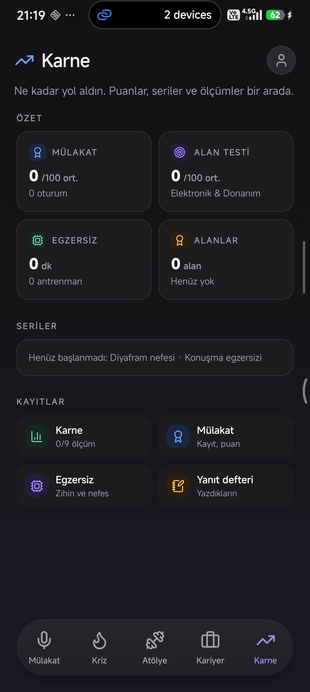

# İrtifa

**Mülakata ve iş hayatına hazırlanmak için bir cep uygulaması.**

---

## Bu uygulama ne işe yarıyor?

Bir mülakata hazırlanmak genelde şöyle geçer: sorulara internetten bakılır,
birkaç tanesi ezberlenir, gerisi şansa kalır. Gerçek mülakatta ise karşınızda
biri olur, süre kısıtlıdır, soru sırası beklenmedik olabilir ve stres gerçektir.

İrtifa bu farkı kapatmaya çalışıyor: **soruyu okumak yerine onu gerçekten
cevaplamanız** için kurulmuş bir pratik ortamı. Kamerayla, mikrofonla ya da
yazarak cevap verirsiniz; uygulama (isterseniz yapay zekâ ile) sizi gerçek bir
mülakatçı gibi değerlendirir — ne iyi gitti, nerede dolgu kelime kullandınız,
cevabınız sorunun neresine değmedi.

İş sadece mülakat günüyle de bitmiyor: başvurularınızı takip etmek, bir cevabı
STAR yöntemiyle kurgulamak, görüştüğünüz şirket hakkında not tutmak, maaş
görüşmesini önceden bir kez denemiş olmak — hepsi aynı uygulamada.

**Önemli bir tasarım kararı:** yapay zekâ tamamen isteğe bağlı. Kendi Google
Gemini anahtarınızı girerseniz değerlendirme ve puanlama devreye girer; hiç
anahtar girmeseniz de uygulamanın hiçbir ekranı bozulmaz — sadece otomatik
puanlama yerine kendi kendinizi değerlendirirsiniz. Sunucu yok, hesap yok,
reklam yok.

---

## Nasıl çalışıyor? (5 sekme)

### 🎤 Mülakat
Giriş ekranı. Günün iki görevi burada bekler: **günün mülakatı** (kurum bazlı,
canlı bir simülasyon) ve **günün alan testi** (hedef alanınıza göre kısa,
yazılı bir test). Geçmiş mülakatlarınızı ve sektör haberlerini de burada
görürsünüz.

### 🔥 Kriz
Baskı altında cevap verme provası. Kasıtlı olarak dar tutulmuş süreler var:
10 saniye düşünme, 90 saniye cevap. Aynı ekranda ayrı bir mod olarak **maaş
görüşmesi provası** da bulunuyor.

### 🏋️ Atölye
Mülakatın kendisi değil, ona hazırlayan kısa egzersizler: nefes kontrolü,
diksiyon (konuşurken netlik), kamera önünde duruş. Hepsi "genel sağlık
tavsiyesi" değil, komite karşısına çıkmadan önceki birkaç dakikaya hizmet
ediyor. Günlük pratik hatırlatıcıları da buradan ayarlanır.

### 💼 Kariyer
Mülakat dışındaki iş: başvuru takibi (hangi şirkete ne zaman başvurdunuz,
hangi aşamada), STAR yöntemiyle hazırlanmış cevap hikâyeleri, görüştüğünüz
şirketler için notlar, mülakat sonrası takip (teşekkür notu, bekleme süreci).

### 📊 Karne
Gelişiminizi gösteren yer: mülakat puanlarınız, alan testindeki doğruluğunuz,
egzersiz serileriniz, zaman içindeki eğri. Profil ve ayarlara da buradan
ulaşılır.

---

## Sektör sizi seçmiyor, siz sektörü seçiyorsunuz

İrtifa'da kurum, departman, soru havuzu ve yapay zekânın mülakatçı rolü koda
gömülü değil — bir **katalogdan** geliyor. Şu an savunma sanayii ve yazılım
sektörleri hazır; yeni bir sektör eklemek mimariyi değiştirmiyor, kataloğa yeni
bir kayıt eklemek yetiyor. Uygulamanın adı, teması ya da arayüzü hiçbir
sektöre özel değil.

---

## Yapay zekâ nasıl işliyor? (BYOK — kendi anahtarınız)

- Google Gemini'nin ücretsiz katmanında bile kullanılabilecek kişisel bir
  anahtar giriyorsunuz; çağrılar doğrudan Google'a gidiyor, aradan bir sunucu
  geçmiyor.
- Anahtar cihazın güvenli kasasında saklanıyor (işletim sisteminin kendi
  güvenli depolama mekanizması).
- Yapay zekâ kapalıyken hiçbir ekran "hata" vermiyor; sadece otomatik
  değerlendirme yerine siz kendi cevabınızı işaretliyorsunuz.
- Mülakat sırasında yapay zekâ açıksa birkaç düşük çözünürlüklü kare ve ses
  kaydı analiz için Google'a gönderiliyor; görüntü cihazda saklanmıyor, ses
  kaydı cihazda kalıyor.

---

## Neden "İrtifa"?

İrtifa, yükseklik demek. Logodaki "İ" harfinin noktası bilerek yukarı bakan bir
ok ucuna dönüştürülmüş: tek yönü olan, ciddi ve süssüz bir işaret. Lacivert +
zümrüt renk paleti de bilerek sektörsüz seçildi — savunma sanayiine
hazırlanan biri de, yazılıma hazırlanan biri de aynı ekranı kendine ait
görsün diye.

---

## Deneyebilir misiniz?

Şu an uygulama geliştirme aşamasında, mağazalarda değil. Kurulum ve geliştirme
adımları için [README.md](README.md) dosyasına bakabilirsiniz.
